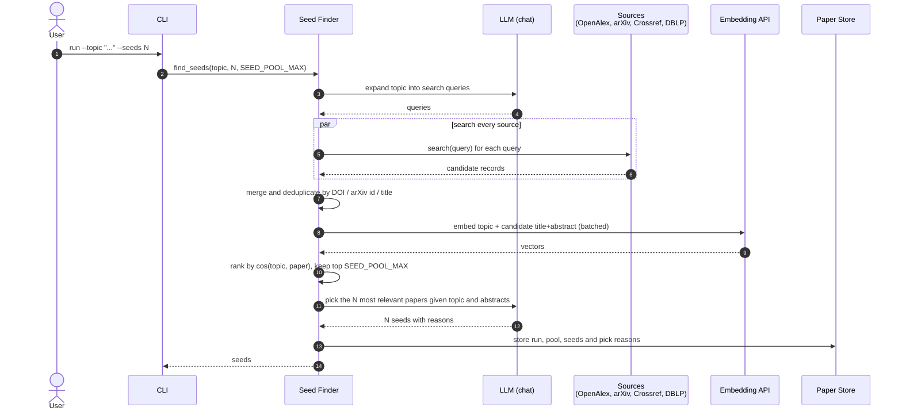
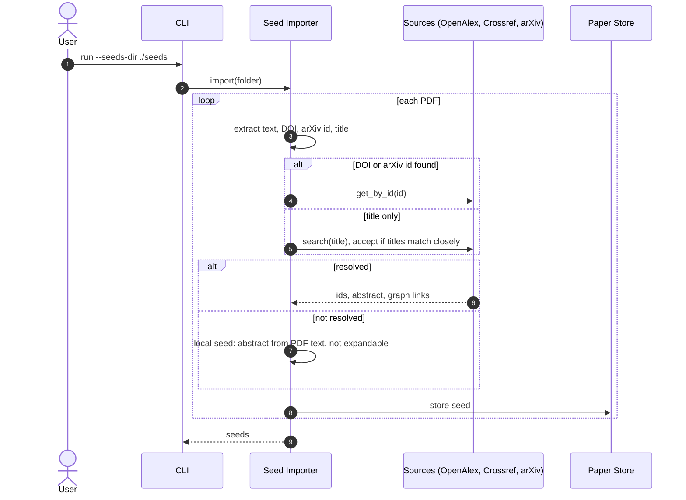
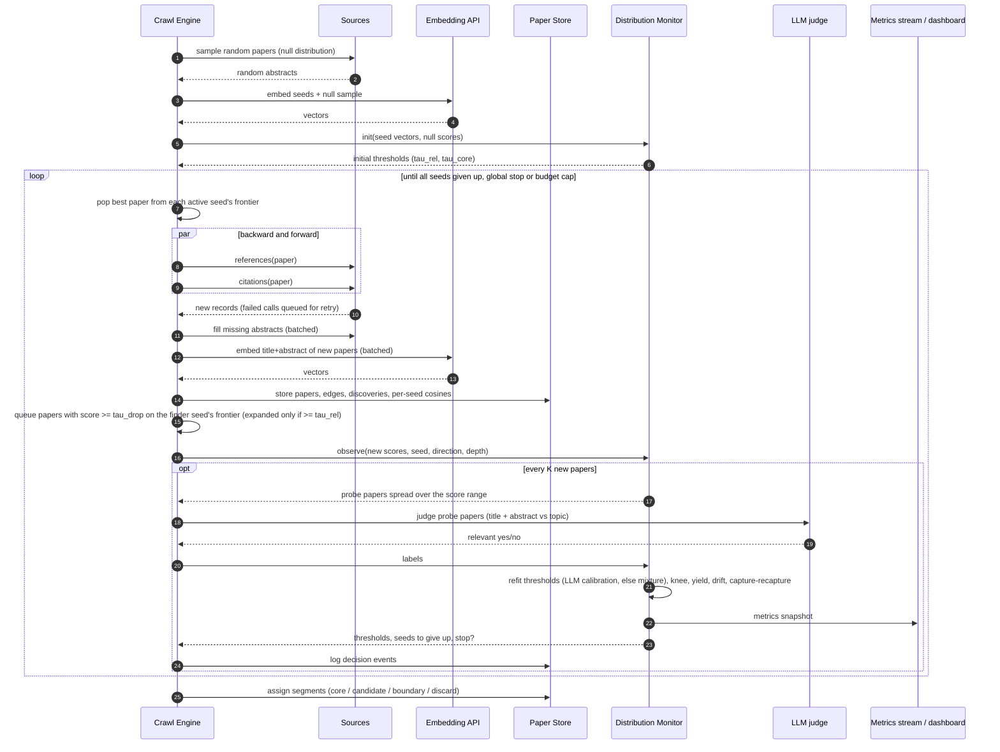
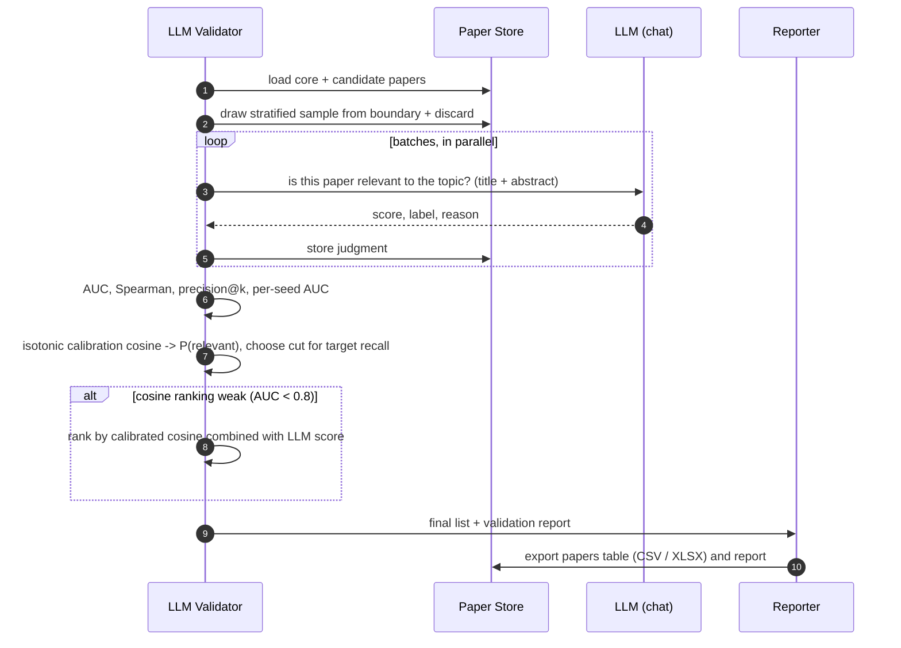

# Sequence diagrams

Four flows, in the order a run executes them. Component names match [system-design.md](system-design.md).

## 1. Seeds from a topic (topic mode)

## 2. Seeds from a PDF folder (PDF mode)

## 3. Snowball with live distribution monitoring

## 4. LLM validation of the selected segment

