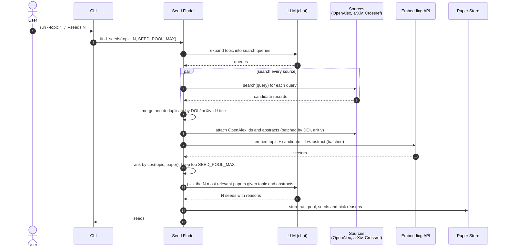
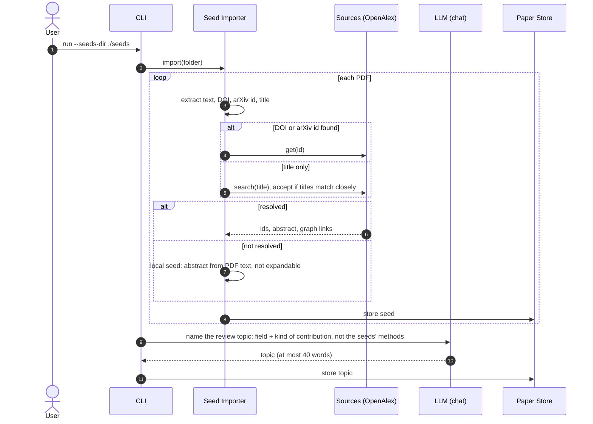
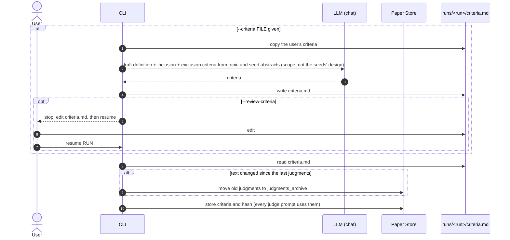
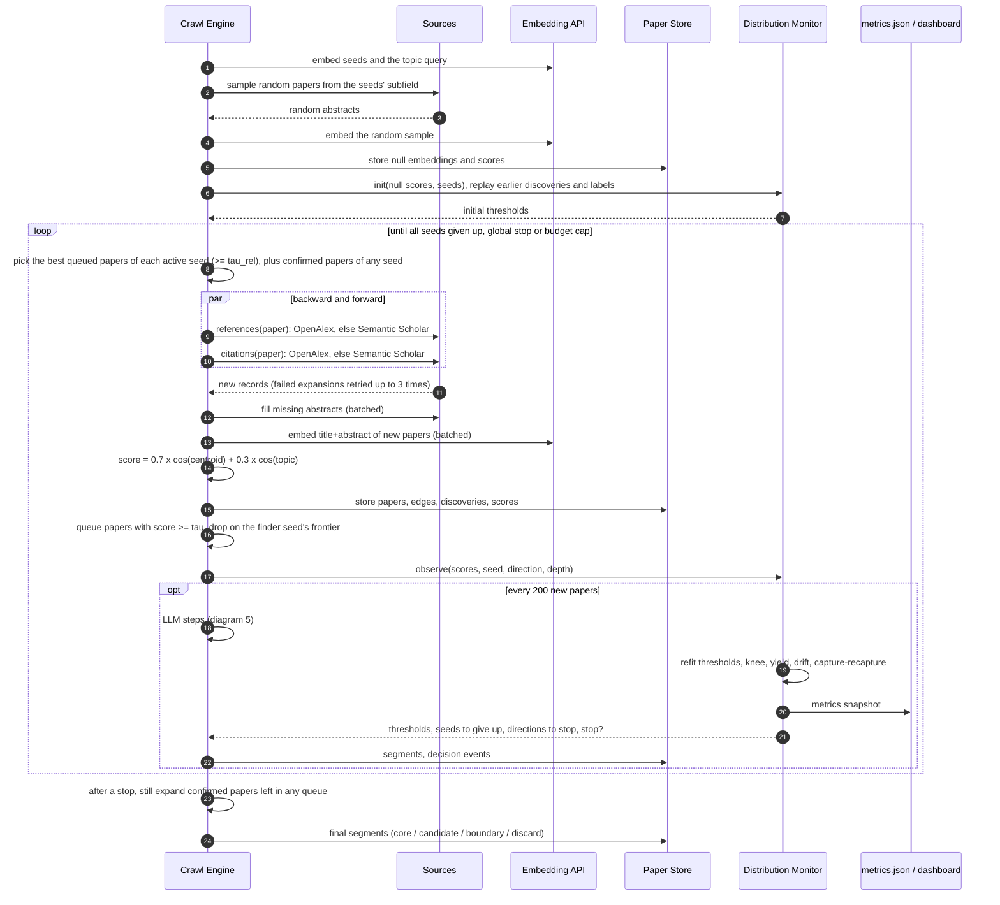

# Sequence diagrams

Seven flows: six in the order a run executes them, then the web app. Component names match [system-design.md](system-design.md).

## 1. Seeds from a topic (topic mode)



## 2. Seeds from a PDF folder (PDF mode)



## 3. Review criteria



## 4. Snowball with live monitoring



## 5. LLM steps at each refit

```mermaid
sequenceDiagram
    autonumber
    participant CE as Crawl Engine
    participant DM as Distribution Monitor
    participant LLM as LLM (chat)
    participant SRC as Sources
    participant DB as Paper Store

    DM-->>CE: probe papers spread over the score range (M9)
    CE->>LLM: judge probes against criteria.md
    LLM-->>CE: score, relevant, reason
    CE->>DM: labels -> logistic P(relevant | score) -> tau_drop, tau_rel, tau_core
    opt thresholds are LLM-calibrated
        CE->>DB: unjudged papers with score >= tau_drop
        CE->>LLM: judge them against criteria.md
        LLM-->>CE: labels
        CE->>DB: confirmed: priority = score + 1 (always expanded, both directions)
        CE->>DB: rejected and below tau_core: frontier state rejected
    end
    opt papers with LLM score >= 9 and score >= tau_rel (max 2 per refit, 5 per run)
        CE->>DB: promote to seeds, frontier from their known neighbours
        CE->>CE: new centroid: rescore all papers and the random baseline
        CE->>DM: rebuild with the new scores
    end
    opt 15 new confirmed papers since the last search (max 5 rounds)
        CE->>LLM: new keyword queries from confirmed titles and earlier queries
        LLM-->>CE: paper queries + short repository queries
        CE->>SRC: paper queries: OpenAlex, arXiv, Crossref
        CE->>SRC: repository queries (first: the topic in 2-4 words): GitHub (stars >= 10)
        SRC-->>CE: records
        CE->>SRC: GitHub repo with an arXiv link in its README -> fetch that paper instead
        CE->>CE: drop repos named like a paper already found (its code)
        CE->>DB: store, embed, score; queue those >= tau_drop (direction search)
    end
    CE->>CE: revive seeds given up by M6 whose queue now holds papers >= tau_rel
```

## 6. Final check and passes

```mermaid
sequenceDiagram
    autonumber
    participant CLI
    participant CE as Crawl Engine
    participant VA as LLM Validator
    participant DB as Paper Store
    participant LLM as LLM (chat)
    participant RP as Reporter

    loop at most 3 passes
        CLI->>CE: run crawl (diagrams 4 and 5)
        CLI->>VA: validate
        VA->>DB: unjudged papers >= tau_drop + discard sample topped up to 200
        loop in parallel
            VA->>LLM: judge against criteria.md
            LLM-->>VA: score, relevant, reason
            VA->>DB: store judgment
        end
        VA->>VA: AUC, Spearman, precision@k, per-seed AUC (weighted by segment sampling rate)
        VA->>VA: isotonic calibration score -> P(relevant), cut for target recall, relevant left in discard
        VA->>VA: order: 0.5 calibrated + 0.5 LLM score (judged), ties by raw score; flag AUC < 0.8 as weak
        VA->>DB: final list
        alt confirmed papers not yet expanded
            CLI->>DB: state = crawling, next pass
        else
            CLI->>CLI: done
        end
    end
    CLI->>RP: export
    RP->>DB: papers.xlsx, papers.csv, summary.json
```

## 7. Web app: start a review, watch it, browse results

```mermaid
sequenceDiagram
    autonumber
    actor User
    participant UI as Browser (React)
    participant API as FastAPI
    participant WDB as web.db
    participant JR as Job runner
    participant P as litscout process
    participant RS as runs/<run>

    User->>UI: sign in
    UI->>API: POST /api/auth/login
    API->>WDB: check bcrypt hash, store session token hash
    API-->>UI: httpOnly SameSite=Strict cookie
    User->>UI: new review (topic, or PDFs)
    UI->>API: POST /api/jobs (multipart, X-Requested-With)
    API->>API: validate topic / PDF type, size, count; cost limit
    API->>WDB: job row (queued); PDFs to uploads/<job>
    loop every 2 s
        JR->>WDB: queued jobs, running count
        JR->>P: spawn run (own session, MAX_COST_USD) when a slot is free
        JR->>P: poll exit code / pid
        JR->>RS: criteria.md exists -> delete uploads/<job>
        JR->>WDB: status: completed / failed / cancelled / awaiting_criteria
    end
    P->>RS: store.sqlite, metrics.json, job.log, criteria.md, output/
    loop every 4 s while running
        UI->>API: GET /api/jobs/<id>, /progress
        API->>RS: read-only: stage from log, metrics, log tail
        API-->>UI: status, stage, tiles, charts, decisions
    end
    opt paused for criteria
        User->>UI: edit criteria, save and continue
        UI->>API: PUT /criteria, POST /resume
        API->>WDB: job queued again -> runner spawns resume --recrawl
    end
    User->>UI: browse results
    UI->>API: GET /papers?view&q&sort&page, /paper?pid, /seeds, /export/xlsx
    API->>RS: read-only queries
    API-->>UI: rows, details, file
```
