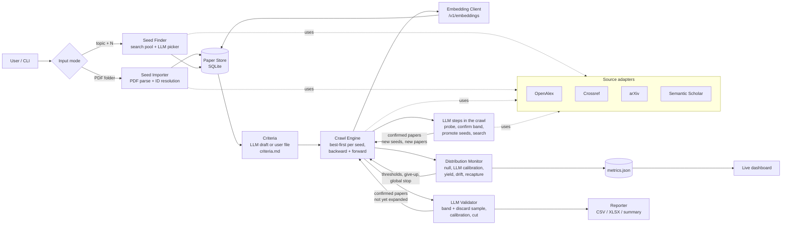
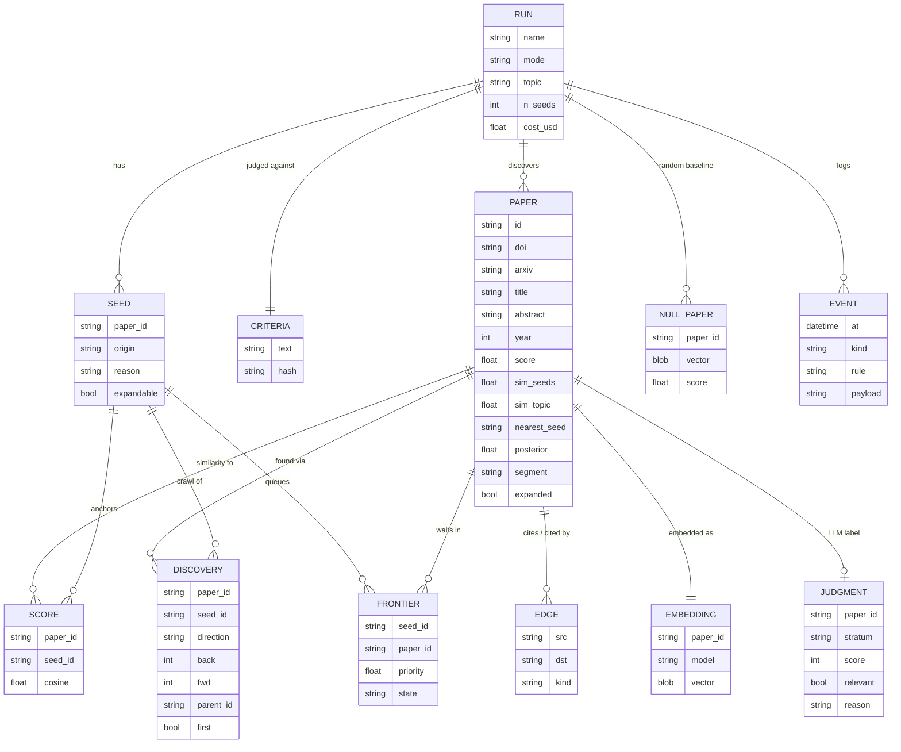

# System design: Systematic Literature Review (target 1, phase 1)

## Goal

Given a research topic or a set of seed papers, find the papers that belong in a systematic review of
that topic. The system snowballs through the citation graph in both directions and scores every paper
by embedding similarity to the seeds and the topic. It decides live where to expand and when to give
up on a seed, has an LLM screen the uncertain band against written review criteria, and reports how
well the similarity ranking matched the LLM.

Phase 2 (for example a RAG system over the selected papers) is out of scope for this document.

## Inputs and outputs

| Input | Meaning |
|---|---|
| `--seeds-dir <path>` | Folder of seed paper PDFs. The seeds are given. |
| `--topic "<text>" --seeds <N>` | Topic string and the number of seeds to pick. The system finds the seeds itself. |
| `--criteria <file>` | Optional review criteria (Markdown). Without it the LLM drafts them. |
| `--review-criteria` | Optional: stop after drafting `criteria.md` so the user can edit it, then `resume`. |
| `SEED_POOL_MAX` (env) | Topic mode only: size of the candidate pool the LLM picks seeds from. |

| Output | Meaning |
|---|---|
| `runs/<run>/criteria.md` | The review criteria every LLM judgment uses; editable |
| `papers.xlsx` / `papers.csv` | Every discovered paper: metadata, abstract, score, similarity to seeds and topic, segment, LLM score and reason, provenance |
| `metrics.json` + dashboard | Live distribution, thresholds, LLM calibration, per-seed yield and stopping decisions ([distribution-analysis.md](distribution-analysis.md)) |
| Validation report (`summary.json`) | Ranking quality (AUC, Spearman, precision@k), calibrated cut, estimated relevant papers left in the discard segment |
| Final list | Papers the LLM confirmed, plus unjudged papers above the calibrated cut |

## Architecture

## Components

### Source adapters
One interface (`search`, `get`, `references`, `citations`, `sample`) over free scholarly APIs, with
rate limiting and retries with backoff. A failed expansion is retried up to 3 times.

| Source | Used for | Limits |
|---|---|---|
| OpenAlex | search, references, citations, abstracts (batched by DOI), random `sample` for the null distribution | free; own quota with `OPENALEX_API_KEY` |
| arXiv | search, abstracts for preprints | free, about 1 request / 3 s |
| Crossref | search | free, polite pool with contact email |
| Semantic Scholar | references and citations when OpenAlex has none (common for recent arXiv preprints) | free but slow without `S2_API_KEY` |
| DBLP | disabled by default: the API answers scripts with an anti-bot page | — |

Records are merged by OpenAlex id, DOI, arXiv id and normalised title. Unresolved reference strings and
non-paper records (datasets, errata, replication packages) are dropped.

### Seed Importer (PDF mode)
1. Extract text from each PDF. Find a DOI and arXiv id by pattern, and the title from PDF metadata or
   the largest text on the first page.
2. Resolve the paper on OpenAlex (by DOI, arXiv id, else title search with a similarity check).
3. If it can't be resolved, keep it as a local seed: it anchors the similarity but can't be expanded.
4. The LLM writes a one-paragraph topic from the seeds' titles and abstracts.

### Seed Finder (topic mode)
1. The LLM expands the topic into a few search queries; OpenAlex, arXiv and Crossref are searched.
2. Merge and deduplicate. Rank the pool by cosine similarity to the topic and keep the top
   `SEED_POOL_MAX`.
3. **LLM seed picker:** from the pool's titles and abstracts, pick the `N` most relevant papers, with a
   reason for each. Relevance is the only criterion; no spread across subtopics.

### Review criteria
After the seeds, the LLM drafts a definition plus 3–6 inclusion and 3–6 exclusion criteria from the
topic and the seeds' abstracts (or the user supplies a file). They are written to
`runs/<run>/criteria.md`, and every LLM judgment in the run (probes, band check, final check) is made
against that text. The file can be edited at any time; on the next `resume` or `validate`, judgments
made under the old criteria are moved to `judgments_archive` and the papers are judged again.

### Paper Store
SQLite file per run (one file, easy to copy and inspect), resumable. Main tables: `papers`, `seeds`,
`discoveries`, `edges`, `embeddings`, `scores`, `frontier`, `null_scores`, `null_embeddings`,
`judgments`, `judgments_archive`, `events`, `meta`, and `final` after validation.

### Embedding Client
The provider's OpenAI-compatible `/v1/embeddings` endpoint, model `EMBEDDING_MODEL`
(`qwen/qwen3-embedding-8b`, 4096 dimensions), 64 texts per request. A paper is embedded once, as
`title + "\n\n" + abstract` (title alone when no abstract can be found). The topic is embedded once as
an instructed query (`Instruct: … Query: <topic>`).

### Scoring
`score = (1 − w) · cos(paper, seed centroid) + w · cos(paper, topic query)`, with `w = 0.3`.
Per-seed cosines are stored too; the nearest seed is reported. Whenever the seed set changes (a
promoted seed), every paper and the random baseline are rescored from the stored embeddings.

### Crawl Engine
- One priority frontier per seed, ordered by score (best-first). Papers at or above `τ_drop` are
  queued; only papers at or above `τ_rel` are expanded.
- Expanding a paper fetches its references (backward) and citations (forward), OpenAlex first and
  Semantic Scholar as fallback, then embeds and scores the new papers.
- Each discovery records seed, direction, depth and parent; rediscoveries through another seed are
  recorded too (M7, M8).
- At every refit (every 200 new papers) it runs the LLM steps below, then asks the Distribution
  Monitor for thresholds and decisions.
- It runs until every seed is given up, the global stop fires, or a budget cap is reached. Papers the
  LLM confirmed are expanded even after that.

### LLM steps during the crawl
Run at every refit, in this order:
1. **Probe (M9):** judge up to 40 papers spread over the score range (at most 400 per run) to calibrate
   the thresholds.
2. **Confirm the band:** once the thresholds are LLM-calibrated, judge every unjudged paper at or above
   `τ_drop`.
3. **Apply labels:** confirmed papers go to the front of the queue and are always expanded, in both
   directions, even below `τ_rel` and even if their seed was given up. Rejected papers below `τ_core`
   are not expanded.
4. **Promote seeds:** papers with LLM score ≥ 9 and score ≥ `τ_rel` become seeds (at most 2 per refit,
   5 per run). They join the centroid, get their own frontier, and everything is rescored.
5. **Search:** after every 15 new confirmed papers (at most 5 rounds), the LLM writes new keyword
   queries from the confirmed titles and the earlier queries; the results are scored and queued like
   crawl discoveries. This finds recent papers the citation graph doesn't link yet.

### Distribution Monitor
Implements the methods in [distribution-analysis.md](distribution-analysis.md):
- M1 null distribution
- M2 mixture thresholds (fallback before enough LLM labels exist)
- M3 knee cross-check
- M4 per-seed yield
- M5 depth drift (AUC vs null and relevant rate per level)
- M6 frontier gating
- M7 capture–recapture (citation crawls only; keyword-search finds are not captures)
- M8 rediscovery rate
- M9 LLM calibration of the thresholds

It writes a metrics snapshot per refit and returns decisions: thresholds, seeds to give up, directions
to stop, and whether to stop. Every decision is logged with the rule that fired.

### Live dashboard
A static page that reloads `metrics.json` every 5 s: tiles (papers, segments, `τ_rel`, confirmed papers,
promoted seeds, search rounds, recall, cost), score histogram with the null and thresholds, progress
over refits, LLM calibration plot, seeds table and decision log. `litscout dashboard` serves only the
page and the metrics file, optionally behind a password.

### LLM Validator
- Judges every remaining paper at or above `τ_drop` and tops up a 200-paper sample of the discard
  segment; earlier judgments are reused.
- Measures how well the score ranking matches the labels (AUC, Spearman, precision@k, per-seed AUC),
  weighting each judged paper by its segment's sampling rate.
- Calibrates score to P(relevant) with isotonic regression, chooses the cut for the target recall, and
  estimates how many relevant papers remain in the discard segment.
- If it confirms papers that were never expanded, the crawl runs again (at most 3 passes in total).

### Reporter
Exports `papers.xlsx` (Final list, All scored papers, Seeds, Run summary), `papers.csv` and
`summary.json` (criteria, queries, thresholds, validation, cost).

## Configuration (environment)

| Variable | Purpose |
|---|---|
| `LLM_BASE_URL`, `LLM_API_KEY` | OpenAI-compatible provider (chat + embeddings) |
| `LLM_MODEL` | chat model for queries, seed picking, criteria and judgments |
| `EMBEDDING_MODEL` | embedding model on the same provider |
| `SEED_POOL_MAX` | topic mode: candidate pool size before LLM seed picking |
| `OPENALEX_API_KEY` | optional, own OpenAlex quota |
| `S2_API_KEY` | optional, Semantic Scholar quota (faster crawl of recent preprints) |
| `CONTACT_EMAIL` | polite-pool header for OpenAlex and Crossref |
| `MAX_PAPERS`, `MAX_COST_USD` | budget caps for a run |
| `DASHBOARD_PASSWORD` | optional password for the dashboard (user name `review`) |

Tuning (scoring weights, thresholds, probe and confirm sizes, promotion and search limits) is in
`config/default.yaml`.

## Data model

`direction` is `refs`, `cits` or `search`. Frontier `state` is `queued`, `done`, `failed` or `rejected`
(LLM said not relevant). Confirmed papers get `priority = score + 1`, so they come before any unjudged
paper.

## Cost and scale (estimates)

Measured on the first end-to-end run: about $0.00017 per LLM judgment and $0.0026 per 1,000 embedded
papers, so the LLM judgments are nearly all of the cost.

| Run | Papers | Judged | Cost |
|---|---|---|---|
| Narrow topic | ~2,500–10,000 | ~1,000–3,000 | ~$0.2–0.5 |
| Broad topic | ~50,000 | ~6,000 | ~$1.2 |

Time is the real limit: source API throughput, mostly Semantic Scholar without a key.

## Reuse from the earlier prototype

OpenAlex, arXiv and Semantic Scholar clients; rate-limited HTTP with retry; record merging and
non-paper filtering; output table writer. The prototype ran an LLM gate on every paper. This system
ranks by embeddings and spends LLM calls only on the uncertain band, the seeds, the criteria and the
searches.

## Decisions

| Topic | Decision |
|---|---|
| Embedding model | `qwen/qwen3-embedding-8b` on the LLM provider: 32k-token context, 4096 dimensions, about $0.01 per million tokens. Papers are embedded without an instruction; the topic as an instructed query. |
| Paper score | 0.7 × similarity to the seed centroid + 0.3 × similarity to the topic. On the first run's 795 labels: AUC 0.878 for max-over-seeds, 0.907 centroid, 0.911 this mix. |
| Random baseline (null) | Random sample from the seeds' most common OpenAlex subfield; its embeddings are kept so it can be rescored when seeds change. |
| Seed picking (topic mode) | The LLM picks the N most relevant papers only; no diversity requirement. |
| Review criteria | Drafted by the LLM, editable by the user; all judgments use them. A loose topic string made the judge too generous. |
| Live thresholds | Calibrated by LLM probes (M9). The null alone can't separate the topic from its citation neighbourhood. |
| Expansion | By score, plus every LLM-confirmed paper whatever its score. Cosine alone missed relevant papers whose neighbours are relevant. |
| Seed promotion and searches | Strong finds become seeds; keyword searches from confirmed papers run during the crawl. Both target recent papers the citation graph links poorly. |
| Dashboard | Static HTML page reloading `metrics.json`; served without the store or outputs, optional password. |
| Vector storage | float16 (half the size of float32, no measurable effect on ranking). |

## Open questions

1. Store: SQLite or DuckDB, if analytical queries over the stream become heavy.
2. Full-text screening (phase 2) for papers whose abstract is ambiguous.
