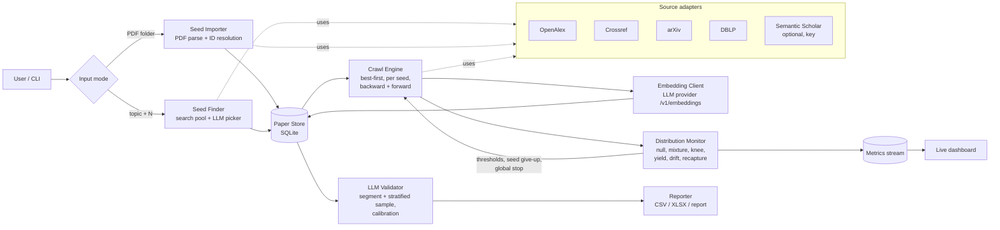
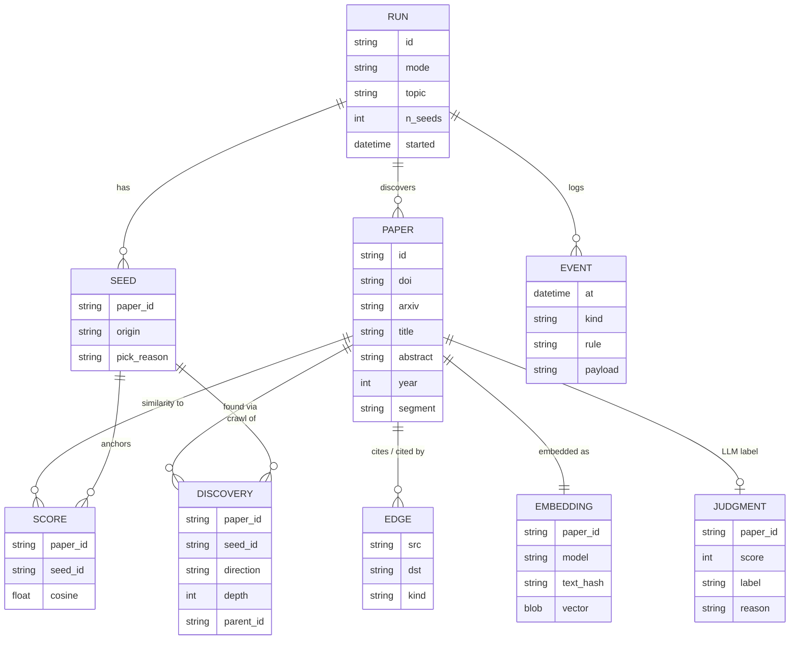

# System design: Systematic Literature Review (target 1, phase 1)

## Goal

Given a research topic or a set of seed papers, find the papers related to them by snowballing through
the citation graph in both directions. Rank them by embedding similarity to the seeds, decide live
when a seed's neighbourhood stops yielding relevant papers, and confirm the most related segment with
an LLM.

Phase 2 (for example a RAG system over the selected papers) is out of scope for this document.

## Inputs and outputs

| Input | Meaning |
|---|---|
| `--seeds-dir <path>` | Folder of seed paper PDFs. The seeds are given. |
| `--topic "<text>" --seeds <N>` | Topic string and the number of seeds to pick. The system finds the seeds itself. |
| `SEED_POOL_MAX` (env) | Topic mode only: size of the candidate pool the LLM picks seeds from. |

| Output | Meaning |
|---|---|
| `papers` table (SQLite, exported to CSV/XLSX) | Every discovered paper: metadata, abstract, score per seed, segment, provenance (seed, direction, depth, parent) |
| Metrics stream + dashboard | Live distribution, per-seed yield and stopping decisions ([distribution-analysis.md](distribution-analysis.md)) |
| Validation report | LLM labels for the selected segment and sample, ranking quality (AUC, Spearman, precision@k), calibrated cut |
| Final list | Papers in the confirmed relevant segment, ordered by calibrated score |

## Architecture

## Components

### Source adapters
One interface (`search`, `get_by_id`, `references`, `citations`, `sample`) over free scholarly APIs,
with the rate limiting, retries with backoff, deferred retry of failed requests and response caching
already proven in the earlier prototype.

| Source | Used for | Limits |
|---|---|---|
| OpenAlex | primary search, references, citations, abstracts, random `sample` for the null distribution | free; own quota with `OPENALEX_API_KEY` |
| Crossref | DOI metadata, references where OpenAlex lacks them | free, polite pool with contact email |
| arXiv | preprint search and abstracts | free, about 1 request / 3 s |
| DBLP | computer-science search and venue metadata | free |
| Semantic Scholar | extra references/citations for arXiv-only papers | optional; heavily rate-limited without `S2_API_KEY` |

Records are merged by DOI, arXiv id and normalised title. Unresolved reference strings and non-paper
records (datasets, errata, replication packages) are dropped.

### Seed Importer (PDF mode)
1. Extract text from each PDF. Find a DOI and arXiv id by pattern, and the title from PDF metadata or
   the first page.
2. Resolve the paper on OpenAlex (by id, else title search with a similarity check) to get its ids,
   abstract and graph links.
3. If it can't be resolved, keep it as a local seed: its abstract comes from the PDF text and it has no
   graph links. It still anchors the similarity, but it can't be expanded.

### Seed Finder (topic mode)
1. Expand the topic into a few search queries (LLM call) and search OpenAlex, arXiv, Crossref and DBLP.
2. Merge and deduplicate. Rank the pool by cosine similarity between the topic embedding and each
   paper's title + abstract, and keep the top `SEED_POOL_MAX`.
3. **LLM seed picker:** given the topic and the pool's titles and abstracts, pick the `N` most relevant
   papers, judging relevance only from topic and abstract, and return a reason for each. Relevance is
   the only criterion; the picker is not asked to spread seeds across subtopics.
4. Store the seeds with their reasons, so the choice can be audited.

### Paper Store
SQLite file per run (one file, easy to copy and inspect):
- `papers`
- `edges` (citation links walked)
- `embeddings` (float32 blob, model name, hash of the embedded text)
- `scores` (per-seed cosine)
- `judgments` (LLM labels)
- `events` (decisions and metrics)

Embeddings are keyed by the text hash and model, so a paper is never embedded twice.

### Embedding Client
Calls the LLM provider's OpenAI-compatible `/v1/embeddings` endpoint. Model from `EMBEDDING_MODEL`
(`qwen/qwen3-embedding-8b`, 4096 dimensions).
Requests are batched, e.g. 64 abstracts per request. The embedded text is `title + "\n\n" + abstract`.
Papers without an abstract are embedded on their title alone and flagged. Abstracts are filled first
from OpenAlex, then Crossref, then arXiv.

### Crawl Engine
- One priority frontier per seed, ordered by the paper's similarity score (best-first).
- Expanding a paper fetches its references (backward) and citing papers (forward). It then embeds and
  scores new papers, and pushes those above the expansion threshold onto the frontier of the seed
  that found them.
- Each paper records the seed, direction, depth and parent of its first discovery. When it is found
  again via another seed, that rediscovery is recorded too (used by M7 and M8).
- After every batch it asks the Distribution Monitor for the current thresholds and decisions.
- It runs until every seed is given up, the global stop fires, or a budget cap is reached (papers,
  API calls, money).
- It is resumable: all state lives in the store.

### Distribution Monitor
Implements the methods in [distribution-analysis.md](distribution-analysis.md):
- M1 null distribution
- M2 mixture thresholds
- M3 knee cross-check
- M4 per-seed yield
- M5 depth drift
- M6 frontier gating
- M7 capture–recapture
- M8 rediscovery rate
- M9 LLM probe calibration (a few judged papers per refit set the thresholds)

It refits after every `K` new papers, writes a metrics snapshot, and returns decisions: thresholds,
seeds to give up, and whether to stop. Every decision is logged with the rule that fired.

### Live dashboard
A static HTML page that reloads the monitor's JSON metrics file every few seconds: histogram with null and mixture overlays,
per-seed panels, yield curves, frontier maxima, estimated recall and the decision log.

### LLM Validator
- Labels all core and candidate papers, plus a stratified sample of boundary and discard papers.
- Measures how well the cosine ranking matches the labels (AUC, Spearman, precision@k, per-seed AUC).
- Calibrates cosine to P(relevant) with isotonic regression and proposes the final cut for a target
  recall.

### Reporter
Exports the papers table (CSV, XLSX), the validation report and the final list.

## Configuration (environment)

| Variable | Purpose |
|---|---|
| `LLM_BASE_URL`, `LLM_API_KEY` | OpenAI-compatible provider (chat + embeddings) |
| `LLM_MODEL` | chat model for query expansion, seed picking and validation |
| `EMBEDDING_MODEL` | embedding model on the same provider |
| `SEED_POOL_MAX` | topic mode: candidate pool size before LLM seed picking |
| `OPENALEX_API_KEY` | optional, own OpenAlex quota |
| `S2_API_KEY` | optional, Semantic Scholar |
| `CONTACT_EMAIL` | polite-pool header for OpenAlex and Crossref |
| `MAX_PAPERS`, `MAX_COST_USD` | budget caps for a run |

## Data model

## Cost and scale (estimates)

- A run is expected to touch tens of thousands of candidate papers, with a relevant segment of a few
  thousand.
- Embedding title + abstract (about 300 tokens) for 50,000 papers is about 15M tokens. That costs
  about $0.15 with an embedding model priced near $0.01 per million tokens.
- LLM validation of 3,000 papers costs about $1 at the current chat model's price.
- The main bottleneck is source API throughput, not compute. OpenAlex with a key is the backbone.

## Reuse from the earlier prototype

- OpenAlex, arXiv and Semantic Scholar clients
- Rate-limited HTTP with retry and deferred retry
- Record merging and non-paper filtering
- LLM judge with versioned judgments
- Output table writer

The earlier prototype used an LLM gate on every paper during the crawl. This system ranks by embedding
similarity and uses the LLM for seed picking, a few hundred calibration probes during the crawl, and
the final validation.

## Decisions

| Topic | Decision |
|---|---|
| Embedding model | `qwen/qwen3-embedding-8b` on the LLM provider: 32k-token context, 4096-dimension vectors, about $0.01 per million tokens. Documents are embedded without an instruction prefix, because paper-to-paper similarity is symmetric. |
| Random baseline (null) | Random sample from the seeds' field: the most common OpenAlex subfield among the seeds (`primary_topic.subfield`), via `/works?sample=…&filter=primary_topic.subfield.id:…`. A global sample can be enabled for diagnostics. |
| Seed picking (topic mode) | The LLM picks the N most relevant papers only; no diversity requirement. |
| Dashboard | Static HTML page that reloads a JSON metrics file. |
| Live thresholds | Calibrated by small LLM probes during the crawl (M9). The null alone can't separate the topic from its citation neighbourhood. |
| Vector storage | float32 vectors are 16 KB per paper (about 800 MB for 50,000 papers). Store as float16 (half the size, no measurable effect on cosine ranking). |

## Open questions

1. Store: SQLite (proposed) or DuckDB, if analytical queries over the stream become heavy.
